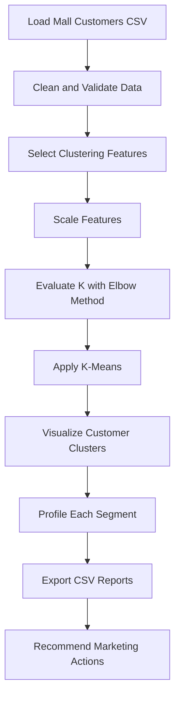

<div align="center">

# 🎯 Customer Segmentation Using K-Means

### Turning customer data into actionable marketing insights

A machine learning project that groups customers by **age, annual income, and spending score** to help businesses understand customer behavior and design more focused marketing campaigns.

<br/>


</div>

---

## 📌 About the Project

Customer segmentation is the process of dividing customers into groups with similar characteristics or behaviors. This project uses the **Mall Customers dataset** and the **K-Means clustering algorithm** to discover customer groups based on demographic and spending information.

The results can help businesses identify high-spending groups, understand customers with lower engagement, and plan relevant promotions, loyalty programs, and personalized recommendations.

## ✨ Key Features

- 🧹 **Data preprocessing** — remove duplicates and handle missing or invalid numeric values.
- 📏 **Feature scaling** — standardize numerical features using `StandardScaler`.
- 📉 **Elbow Method** — compare candidate cluster counts using within-cluster inertia.
- 🤖 **K-Means clustering** — assign each customer a cluster label.
- 📊 **Cluster visualization** — plot customer groups for easier interpretation.
- 🔎 **Segment profiling** — summarize average age, annual income, and spending score.
- 🎁 **Marketing insights** — suggest targeted actions for each customer segment.
- 📁 **Exportable results** — save customer labels and cluster summaries to CSV files.

## 🧰 Tech Stack

| Technology | Purpose |
|---|---|
| Python | Main programming language |
| Pandas | Data loading, cleaning, and analysis |
| NumPy | Numerical operations |
| Scikit-learn | Feature scaling and K-Means clustering |
| Matplotlib | Charts and visualizations |

## 🗂️ Project Structure

```text
customer-segmentation-kmeans/
├── Mall_Customers.csv
├── customer_segmentation.py
├── requirements.txt
├── README.md
└── outputs/
    ├── customer_clusters.csv
    ├── cluster_profile_report.csv
    ├── elbow_method.png
    └── customer_clusters_age_spending.png
```

> The script generates the `outputs/` directory when it runs. The exact output files depend on the version of the script you use.

## 📊 Dataset

The dataset contains customer demographic and spending information.

| Column | Description |
|---|---|
| `CustomerID` | Unique customer identifier; excluded from clustering |
| `Gender` | Customer gender |
| `Age` | Customer age |
| `Annual Income (k$)` | Annual income, in thousands of dollars |
| `Spending Score (1-100)` | Spending behavior score |

## ⚙️ Workflow



### 1. Data Cleaning
- Remove duplicate records.
- Convert selected features to numeric values.
- Exclude records missing required clustering features.
- Clean text fields such as gender when available.

### 2. Feature Scaling
`StandardScaler` is used on **Age**, **Annual Income**, and **Spending Score** so that differences in feature ranges do not dominate distance calculations.

### 3. Choosing the Number of Clusters
The Elbow Method fits models for different values of K and plots inertia. Look for the point where additional clusters produce smaller improvements. The script uses **K = 5** as an initial, interpretable choice; validate this choice against the elbow curve and, where useful, silhouette scores.

### 4. Customer Profiling
After clustering, summarize the number of customers and their average age, income, and spending score. Cluster numbers are arbitrary labels—not rankings.

## 📈 Visualizations

The project generates visualizations such as:

| Visualization | What it shows |
|---|---|
| `elbow_method.png` | Inertia for different cluster counts |
| `customer_clusters_age_spending.png` | Customer clusters by age and spending score |
| `customer_clusters_income_spending.png` | Customer clusters by annual income and spending score, if generated by your script |

To display a saved chart directly in this README after uploading it to GitHub, you can add:

```markdown


```

## 🎯 Example Marketing Strategies

| Customer pattern | Possible action |
|---|---|
| High income + high spending | Premium bundles, loyalty rewards, personalized upselling |
| High income + low spending | Curated recommendations and value-focused offers |
| Lower income + high spending | Affordable bundles and points-based rewards |
| Lower income + low spending | Budget-friendly products and carefully tested promotions |
| Older customers with moderate spending | Convenient service and relevant retention offers |

*These are example strategies. Use each cluster's actual profile statistics to decide which action is appropriate.*

## 🚀 Getting Started

### Prerequisites
- Python 3.10 or later
- `pip`

### 1. Clone the repository

Replace `YOUR-USERNAME` with your GitHub username.

```bash
git clone https://github.com/YOUR-USERNAME/customer-segmentation-kmeans.git
cd customer-segmentation-kmeans
```

### 2. Install dependencies

```bash
pip install -r requirements.txt
```

If you need to create `requirements.txt`, include:

```text
pandas
numpy
matplotlib
scikit-learn
```

### 3. Run the project

Keep `Mall_Customers.csv` in the project root, then run:

```bash
python customer_segmentation.py
```

The script should create the output folder and save the cluster labels, profile report, and charts.

## 📦 Output Files

| File | Description |
|---|---|
| `customer_clusters.csv` | Customer records with an assigned cluster label |
| `cluster_profile_report.csv` | Summary statistics for each cluster |
| `elbow_method.png` | Elbow curve used to assess candidate values of K |
| `customer_clusters_age_spending.png` | Age-versus-spending cluster chart |

## ✅ Results and Evaluation

Use the generated cluster profile report to compare segments. A silhouette score can provide an additional measure of how well-separated the clusters are; its interpretation depends on the dataset and chosen features. Do not treat a single score as proof that the segmentation is optimal.

## 🌟 Applications

- Retail and mall customer analysis
- Targeted advertising and promotions
- Customer loyalty and retention programs
- Personalized product recommendations
- Customer behavior analysis
- Marketing campaign planning

## ⚠️ Limitations

- K-Means can be affected by outliers and feature selection.
- The chosen value of K influences the resulting groups.
- Cluster IDs have no inherent order or business meaning.
- The Mall Customers dataset is small and may not represent real customer populations.
- Marketing hypotheses should be validated with sales data and campaign experiments.

## 🔮 Future Improvements

- Build an interactive **Streamlit dashboard**.
- Compare K-Means with hierarchical clustering and DBSCAN.
- Evaluate candidate cluster counts with silhouette scores.
- Add purchase history and transaction-level features.
- Generate downloadable segment-specific marketing reports.
- Retrain and validate the model on a larger, representative dataset.

## 🏁 Conclusion

This project demonstrates an end-to-end customer segmentation workflow using data cleaning, feature scaling, the Elbow Method, K-Means clustering, visualization, and segment profiling. It provides a foundation for turning customer data into practical, testable marketing ideas.

## 👩‍💻 Author

**Your Name**  
GitHub: [YOUR-USERNAME](https://github.com/Priyadharshinipalanisami)

> Replace the author placeholders before publishing.

## 📄 License

For academic and educational use. Add a `LICENSE` file if you choose to publish this project under a specific open-source license.

---

<div align="center">

**⭐ If you find this project useful, consider giving the repository a star!**

Made with 🐍 Python and 📊 data science.

</div>
